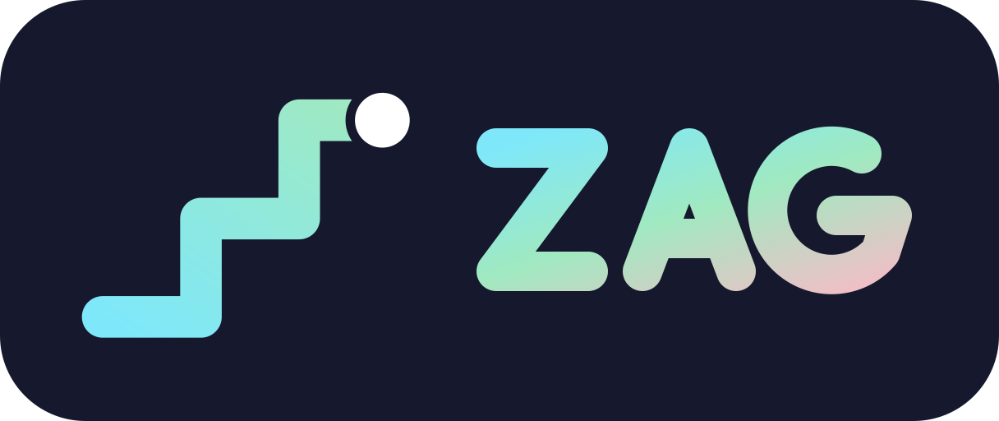

<p align="center">
  
</p>

# ZAG

[](https://github.com/remarkablegames/zag/releases)
[](https://github.com/remarkablegames/zag/actions/workflows/build.yml)

⚡ **ZAG** is a tap-to-turn arcade game where you zigzag your way forward!

Play in your browser:

- [Wavedash](https://wavedash.com/games/zig-zag)
- [itch.io](https://remarkablegames.itch.io/zag)
- [remarkablegames](https://remarkablegames.org/zag/)

Or download for desktop:

- [Windows](https://github.com/remarkablegames/zag/releases/latest/download/windows.zip)
- [macOS](https://github.com/remarkablegames/zag/releases/latest/download/macos.zip)
- [Linux](https://github.com/remarkablegames/zag/releases/latest/download/linux.zip)

Read the [blog post](https://remarkablegames.org/posts/zag/).

## How to Play

The ball rolls along a narrow path that zigzags, turning 90 degrees with each line. Tap, click, or press **Space** to turn.

Time your turn just right. Turn too early or too late, and the ball falls off.

Earn 1 point for each line you cross. The ball speeds up as you play and your high score is saved.

## Controls

Turn with:

- Tap or click
- Space, Enter, or ↑
- Gamepad A

## Features

- Procedurally generated paths
- Mouse, touch, keyboard, and gamepad support
- Responsive design for desktop and mobile
- Speed that ramps up as you play
- A ball with a trail, squash-and-stretch turns, and a fall animation
- Sound effects for turns, scoring, falling, and game over
- High score is saved to `localStorage`
- Online leaderboard, cloud saves, and achievements on [Wavedash](https://wavedash.com)

## Credits

- [Lofi hip hop Volume 1](https://jjbbllkk.itch.io/lo-fi-hip-hop-volume-1) by [Jeremy Leaird-Koch](https://rmr.media/)

## Prerequisites

[nvm](https://github.com/nvm-sh/nvm#installing-and-updating):

```sh
brew install nvm
```

## Install

Clone the repository:

```sh
git clone https://github.com/remarkablegames/zag.git
cd zag
```

Install the dependencies:

```sh
npm install
```

## Available Scripts

In the project directory, you can run:

### `npm start`

Runs the game in the development mode.

Open [http://localhost:5173](http://localhost:5173) to view it in the browser.

The page will reload if you make edits.

You will also see any errors in the console.

### `npm run build`

Builds the game for production to the `dist` folder.

It correctly bundles in production mode and optimizes the build for the best performance.

The build is minified and the filenames include the hashes.

Your game is ready to be deployed!

### `npm run bundle`

Builds the game and packages it into a Zip file in the `dist` folder.

Your game can be uploaded to your server, [itch.io](https://itch.io/), etc.

## Testing

### Cover

Add the `cover` query parameter to view an animated cover:

```
http://localhost:5173/?cover
```
